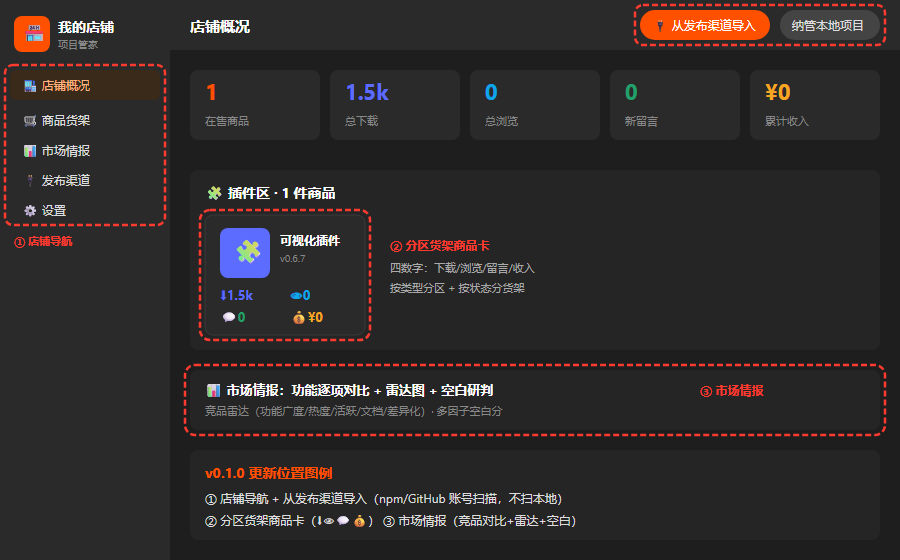

# Changelog

本文件记录 `@chendb888/dsh-project-steward`（项目管家）逐版本变更。
格式参考 [Keep a Changelog](https://keepachangelog.com/)，版本遵循 [SemVer](https://semver.org/)。

## [0.1.3] - 2026-11-28

### Fixed
- **运营采集漏采修复**：移除违反数值 schema 的字符串字段，npm 渠道自动采集恢复（此前漏采两天）。
- **顶部卡片与分项数据同源**：卡片直接由 perProject 汇总，杜绝"上面 0、下面有数"的对不上。

### Added
- **各商品运营列表 + 点击详情**：一行一个商品（按下载排序），点击滑出详情抽屉看总量 + 分渠道明细。
- **分项运营数据**：perProject.channels 每渠道最新快照（下载/昨日/浏览/克隆/留言/star/fork）。
- **页面防缓存拦截器**：tapIndex 注入 fetch no-store，破解浏览器一年 immutable 缓存致界面陈旧。

### Changed
- 下载口径=安装量（npm install / dsh plugin add 命令行均计）；浏览=GitHub 真实页面浏览；克隆独立统计。

## [0.1.0] - 2026-11-23

### Added
- **百货分区货架**：按项目类型分区域 + 区域内按上架状态分货架；商品卡片 ⬇下载 👁浏览 💬留言 💰收入；分类切换（类型/渠道/状态）。
- **店铺概况**：在售商品（唯一项目数）/总下载/总浏览/新留言/累计收入数据卡 + 待处理异常 + 商品分类。
- **常驻「店铺」页签**：conversation.view 注册，同看板插件常驻机制。
- **从发布渠道导入**：扫描 npm maintainer / GitHub 账号发现已上架商品，勾选导入为纳管项目 + listed 上架记录。
- **全自动发布流水线**：6 类模板（dsh-plugin/game/business-system/web-app/engine/host）；守卫链 + 阻断传播 + 豁免；自动 bump patch；auto-publish（npm/镜像/GitHub/市场PR/itch/docker）。
- **发布说明硬门禁**：readme-exists + changelog-nonempty 检查，缺 README/CHANGELOG 阻断发布。
- **定时运营采集**：60min 调度 + 退避 + stale；npm 下载 / GitHub traffic 浏览/克隆 独立口径；留言/付款增量事件 + 紧急推送。
- **市场竞品情报**：竞品发现 + 功能逐项对比矩阵 + 多维雷达图（真实文档质量/功能广度）+ 多因子市场空白研判（实搜 npm/GitHub 供给/需求/竞争）。
- **全项目文档标准**：doc_check/doc_scaffold/doc_complete/maintenance_report + **doc_update_image**（逐版本更新位置标注图 SVG→PNG 推 GitHub）。
- **渠道 CRUD**：增删改查 + 候选库导入（内容类排除）+ 软删除守卫。
- **生产实例保护**：readOnly 渠道零写操作（ILLEGAL_ON_PROTECTED）。
- **journal 审计**：append-only 事实源 + 原子写 + 损坏重放重建 + 凭据脱敏。

### 更新位置

① 店铺导航 + 从发布渠道导入；② 分区货架商品卡（四数字）；③ 市场情报竞品对比。红虚线框 = 核心界面区域。

---

## 维护说明（Maintenance）

### 版本发布流程
1. `node --test`（59 绿）。
2. 更新 CHANGELOG + README 版本更新说明 + 生成版本更新位置图（`steward_doc_update_image`）。
3. bump `package.json` version（SemVer）。
4. staging 公开包 `@chendb888/dsh-project-steward`（去 private），`npm pack --dry-run` 核对文件（须含 README/CHANGELOG/locale/icon/src/index/client）。
5. `npm publish --registry=https://registry.npmjs.org --access public`。
6. 推 GitHub + 更新官方市场条目（awesome-dsh-plugin，PR 合并即上架）。
7. 核实 npm readme 非空、镜像同步、市场条目完整。

### 上架材料硬门禁
README + CHANGELOG + locale(en/zh) + icon 必备，缺失不得发布。

### 数据与安全
- 台账本地落盘 `data/`（JSON + journal.jsonl append-only，可重放重建）。
- 凭据只存引用，不落明文；G3/G4 动作需显式确认；readOnly 生产实例零写操作。
- 投影/工具依赖字段须为数组（防御规范化）。

## 许可

MIT