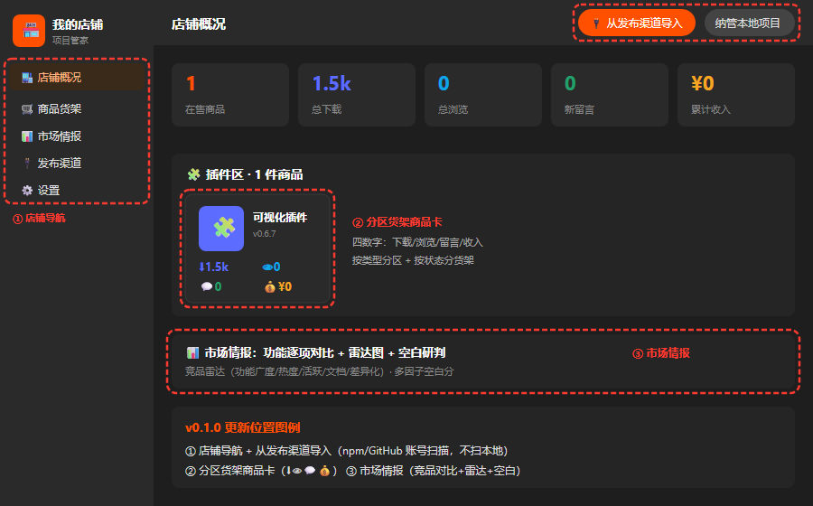

# 项目管家 · Project Steward


> 像经营百货商店一样管理你全部**软件项目**的发布、上架与运营。一个 DSH 插件：分区货架看板 + 全自动发布 + 定时运营采集 + 市场竞品情报 + 全项目文档标准。

## 功能特性

- **🏬 百货分区货架**：按项目类型分区域（插件/游戏/应用/引擎工具/宿主），区域内按上架状态分货架（在售/审核中/待上架/已下架），商品卡片显示 ⬇下载 👁浏览 💬留言 💰收入。分类可切换（类型/渠道/状态）。
- **🔌 从发布渠道导入**：扫描 npm/GitHub 账号发现已上架商品，一键导入货架（不扫本地文件）；本地扫描纳管为可选辅助。
- **⚡ 全自动发布**：构建→测试→检查→自动 bump patch→发布→上架一条龙；失败阻断并通知；**发布说明硬门禁**（README+CHANGELOG 必备）。
- **📊 定时运营采集**：默认 60min 拉取各平台真实数据；下载量（npm）与浏览量（GitHub traffic）独立口径；新留言/付款事件提醒。
- **🔍 市场竞品情报**：按本项目功能逐项对比竞品 + 多维雷达图 + 真实多因子市场空白研判。
- **📝 全项目文档标准**：完整 CHANGELOG + README + 维护说明 + **逐版本更新位置标注图**（一键生成）。
- **🔒 生产实例保护**：readOnly 实例（如阿里云内测）严格只读，禁止写操作。

## 安装

```bash
dsh plugin --profile web add @chendb888/dsh-project-steward
```

或在 DSH 插件管理器安装 `@chendb888/dsh-project-steward`。

## 使用

1. 打开「店铺」视图页签（常驻，同看板插件机制）。
2. 「🔌 从发布渠道导入」扫描你的 npm/GitHub 已上架商品 → 勾选导入货架。
3. 「🛒 商品货架」查看分区货架；点商品看详情（上架渠道/发布记录/竞品研判）。
4. 「📊 市场情报」扫描对比竞品 + 市场空白。
5. 对话中可用 `steward_*` 工具：`steward_release_start`（全自动发布）、`steward_doc_update_image`（生成版本更新图）、`steward_market_compare`（竞品研判）等。

「店铺概况」显示在售商品和渠道上架记录数。npm 下载显示近 30 天总量及最近报告日下载量，包含命令行安装。GitHub 浏览和克隆使用 14 天流量窗口。总数和明细显示精确数值，汇总字段缺失时使用商品上架记录和渠道明细计算。项目管家的中文界面保留原文，避免浏览器翻译改写实时数据。

## 版本更新说明

### 0.1.0（2026-11-23）
- 🎉 首次正式发布。
- 百货分区货架 + 店铺概况数据卡 + 常驻「店铺」页签。
- 从发布渠道导入商品（npm/GitHub 账号扫描）。
- 全自动发布流水线（6 类模板 + 发布说明硬门禁 + 自动 bump patch）。
- 定时运营采集（下载/浏览独立口径 + 克隆量 + 留言/付款事件）。
- 市场竞品情报（功能逐项对比 + 雷达图 + 多因子空白研判）。
- 全项目文档标准（CHANGELOG/README/维护说明 + 逐版本更新位置标注图生成）。
- 渠道 CRUD + 候选库导入；生产实例只读保护；journal 审计。

**更新位置示意**（红虚线框标注核心界面区域）：



> ① 店铺导航 + 从发布渠道导入；② 分区货架商品卡（四数字）；③ 市场情报竞品对比。

## 维护说明

- **发布流程**：`node --test`（59 绿）→ 更新 CHANGELOG/README → bump version → staging 公开包（`npm pack --dry-run` 核对含 README/CHANGELOG/locale/icon/src）→ `npm publish --registry=https://registry.npmjs.org` → 推 GitHub + 更新市场条目 → 核实 npm readme 非空。
- **上架材料硬门禁**：README + CHANGELOG + locale(en/zh) + icon 必备。
- **数据**：全部本地落盘 `data/`（JSON 台账 + journal.jsonl append-only 审计，可重放重建）；凭据只存引用不落明文。
- **安全**：G3/G4 动作（下架/归档/豁免/软删除）需显式确认；readOnly 生产实例零写操作；竞品/留言文本作不可信数据。

## 数据与隐私

- 台账落盘项目目录 `data/`；凭据仅存引用位置（npmrc/gh CLI/skill/server-env），不落明文。
- 卸载不删除 `data/` 台账。

## 许可

MIT
